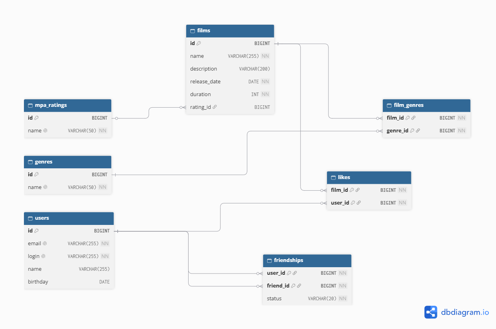

# java-filmorate
Template repository for Filmorate project.

# Filmorate

## ER-диаграмма базы данных



### Таблицы

| Таблица | Что хранит | Первичный ключ |
|---|---|---|
| `mpa_ratings` | справочник рейтингов MPA (G, PG, PG-13, R, NC-17) | `id` |
| `genres` | справочник жанров (Комедия, Драма, Мультфильм, Триллер, Документальный, Боевик) | `id` |
| `users` | пользователи | `id` |
| `films` | фильмы (с `rating_id` на `mpa_ratings`) | `id` |
| `film_genres` | связь «фильм ↔ жанр» (many-to-many) | `(film_id, genre_id)` |
| `likes` | лайки фильмов пользователями (many-to-many) | `(film_id, user_id)` |
| `friendships` | дружба со статусом (`PENDING` / `CONFIRMED`) | `(user_id, friend_id)` |


## Примеры SQL-запросов для основных операций

### Все фильмы с жанрами и рейтингом

**Данные фильма и рейтинг** 
```sql
SELECT f.id,
       f.NAME,
       f.description,
       f.release_date,
       f.duration,
       f.rating_id,
       m.NAME AS mpa_name
FROM   films f
       LEFT JOIN mpa_ratings m
              ON m.id = f.rating_id
ORDER  BY f.id; 
```

**Жанры для этих фильмов**

```sql
SELECT fg.film_id,
       g.id AS gid,
       g.name AS gname
FROM film_genres fg
JOIN genres g ON g.id = fg.genre_id
WHERE fg.film_id IN (1, 2, 3)
ORDER BY fg.film_id, g.id;
```

**Лайки для этих фильмов**

```sql
SELECT film_id,
       user_id
FROM   likes
WHERE  film_id IN ( 1, 2, 3 );
```

**Один фильм по id**

```sql
SELECT f.id,
       f.NAME,
       f.description,
       f.release_date,
       f.duration,
       f.rating_id,
       m.NAME AS mpa_name
FROM   films f
       LEFT JOIN mpa_ratings m
              ON m.id = f.rating_id
WHERE  f.id = 1;
```

**Один пользователь по id**

```sql
SELECT id,
       email,
       login,
       NAME,
       birthday
FROM   users
WHERE  id = 1;
```

**Друзья**

```sql
SELECT user_id,
       friend_id
FROM   friendships
WHERE  user_id IN ( 1, 2, 3 ); 
```

**Все жанры**
```sql
SELECT id, name FROM genres ORDER BY id;
```

**Один жанр по id**

```sql
SELECT id, name FROM genres WHERE id = 1;
```

**Все рейтинги**

```sql
SELECT id, name FROM mpa_ratings ORDER BY id;
```

**Один рейтинг по id**

```sql
SELECT id, name FROM mpa_ratings WHERE id = 1;
```

**Confirmed друзья пользователя**

```sql
SELECT u.*
FROM   users u
       JOIN friendships f
         ON f.friend_id = u.id
WHERE  f.user_id = 1
       AND f.status = 'CONFIRMED'
ORDER  BY u.id; 
```

**Общие друзья**

```sql
SELECT u.*
FROM   users u
       JOIN friendships f1
         ON f1.friend_id = u.id
            AND f1.user_id = 1
            AND f1.status = 'CONFIRMED'
       JOIN friendships f2
         ON f2.friend_id = u.id
            AND f2.user_id = 2
            AND f2.status = 'CONFIRMED'
ORDER  BY u.id; 
```

**Статус дружбы**

```sql
SELECT status
FROM   friendships
WHERE  user_id = 1
       AND friend_id = 2; 
```

---

**Добавить лайк**

```sql
MERGE INTO likes (film_id, user_id)
    KEY (film_id, user_id)
    VALUES (1, 2);
```

**Удалить лайк**

```sql
DELETE FROM likes
WHERE  film_id = 1
       AND user_id = 2; 
```

**Добавить в друзья**

```sql
MERGE INTO friendships (user_id, friend_id, status)
    KEY (user_id, friend_id)
    VALUES (1, 2, 'PENDING');
```

**Удалить пользователя из друзей**

```sql
DELETE FROM friendships
WHERE  user_id = 1
       AND friend_id = 2; 
```

**Сохранить жанр фильма**

```sql
MERGE INTO film_genres (film_id, genre_id)
    KEY (film_id, genre_id)
    VALUES (1, 3);
```

**Создать пользователя**

```sql
INSERT INTO users (email, login, name, birthday)
VALUES ('vasya@example.com', 'vasya', 'Василий', '1990-05-15');
```

**Обновить пользователя**

```sql
UPDATE users
SET    email = 'new@example.com',
       login = 'vasya',
       NAME = 'Новое Имя',
       birthday = '1990-05-15'
WHERE  id = 1; 
```
